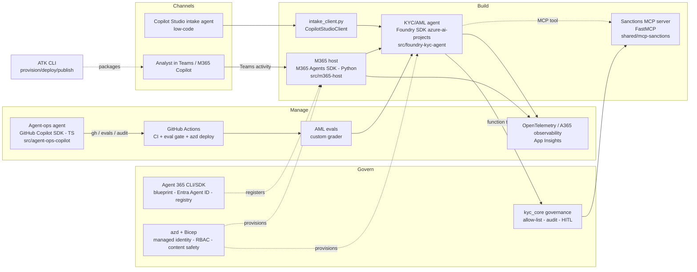

# Architecture

## Request flow (KYC assessment)

1. An analyst asks "Assess CUST-1007" in Teams. ATK packages and sideloads the app, and the M365 Agents SDK host receives the activity.
2. The host calls `kyc_agent`. In live mode this is a Foundry prompt agent driven through the Responses API; in mock mode it is a deterministic rule engine.
3. The agent calls governed tools in this order:
   - `lookup_customer`
   - `screen_name` (sanctions/PEP fuzzy match)
   - `risk_score`
   - optionally `draft_sar`

   Each call is checked against the allow-list, traced, and audited.
4. High risk combined with suspicious activity produces a SAR in `pending_approval`. The host sends an Adaptive Card, and only reviewers listed in `KYC_REVIEWER_IDS` can approve or reject it.
5. Spans go to App Insights (or the console in mock mode) through OpenTelemetry and Agent 365 observability.

## Mode switch

`DEMO_MODE=mock` (default) runs everything offline:

- mock LLM responses
- local synthetic data (`shared/mock`)
- console telemetry
- a scripted Copilot SDK demo

`DEMO_MODE=live` uses Foundry, App Insights, Teams, Copilot Studio and the Copilot CLI. See [CONTRACTS.md](CONTRACTS.md).

## Ports

| Component | Port |
| --- | --- |
| M365 host (`/api/messages`, `/healthz`) | 3978 |
| Sanctions MCP (`/mcp`, streamable HTTP) | 8765 |
